# Agritech — Nhận diện & tư vấn bệnh lúa trên Raspberry Pi 4

Chụp (hoặc chọn) ảnh lá lúa → model **YOLO11s-cls** (ONNX, chạy bằng CPU) phân loại 10 lớp
(9 bệnh + khoẻ) → dashboard hiện kết quả, **Grad-CAM** (vùng AI chú ý), biện pháp xử lý và
chatbot tư vấn (ChatGPT). Toàn bộ chạy cục bộ trên Pi, không cần GPU.

Dữ liệu huấn luyện: **Paddy Doctor** (10.407 ảnh, NeurIPS 2022). Kết quả: top-1 ≈ 98%, top-5 ≈ 100%
([results.csv](result_training/results.csv)). Phân tích dataset: [paddy_doctor_report.txt](paddy_analysis_output/paddy_doctor_report.txt).

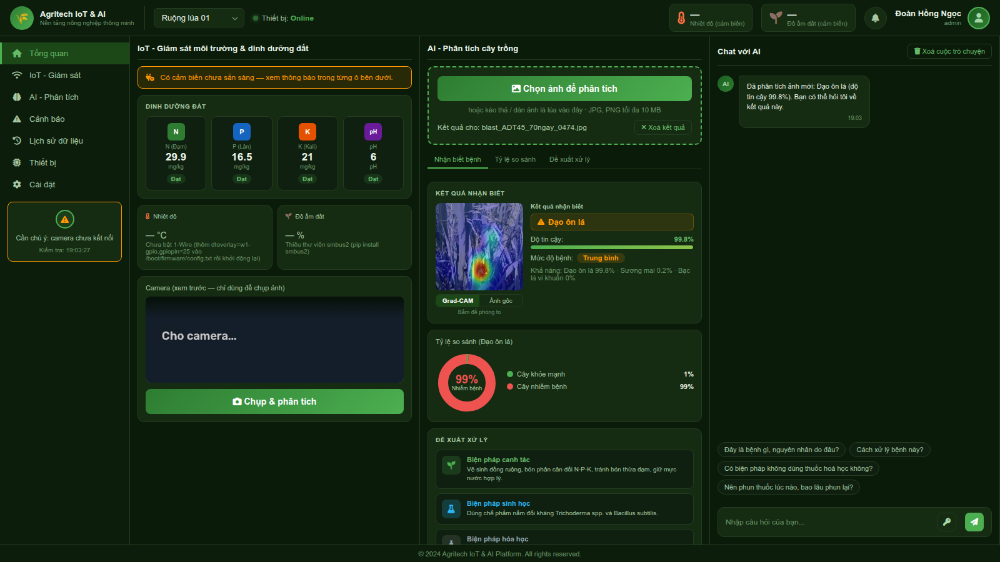

<p align="center"><i>Trang Tổng quan: cột IoT (dinh dưỡng đất, cảm biến, camera) · cột AI (kết quả + Grad-CAM + đề xuất xử lý) · cột Chat với AI</i></p>

## Demo

> Ảnh chụp màn hình dashboard thật (`deploy_pi/server/app.py`) với ảnh trong `deploy_pi/sample_images/`.
> Máy chụp không gắn camera/cảm biến nên các ô đó hiện "chưa sẵn sàng" — trên Pi có phần cứng sẽ hiện số đo thật.

### 1. Luồng sử dụng

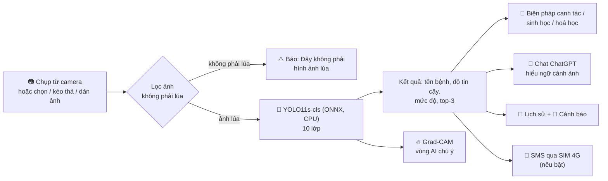

### 2. Kết quả nhận diện

Chọn ảnh → vài giây sau có kết quả. Ba tab: **Nhận biết bệnh** · **Tỷ lệ so sánh** · **Đề xuất xử lý**.

<table>
  <tr>
    <td align="center">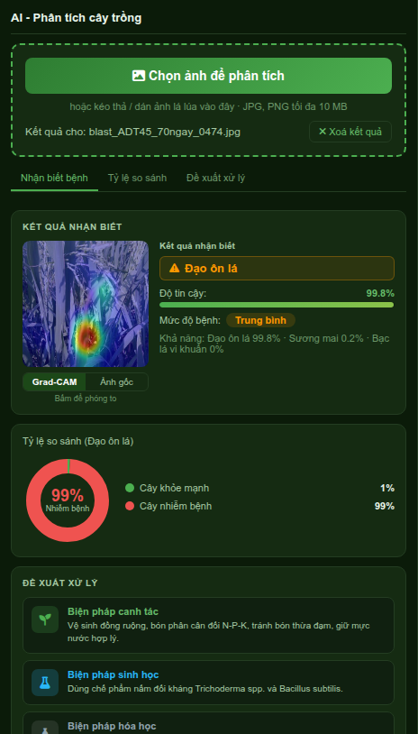</td>
    <td align="center">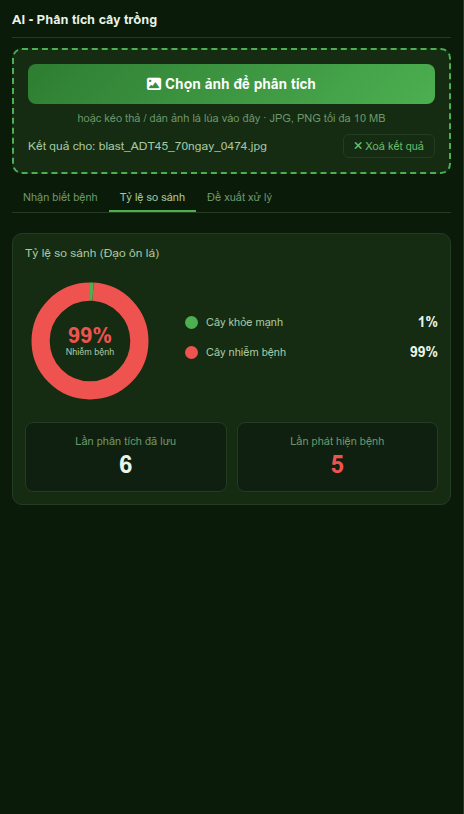</td>
    <td align="center">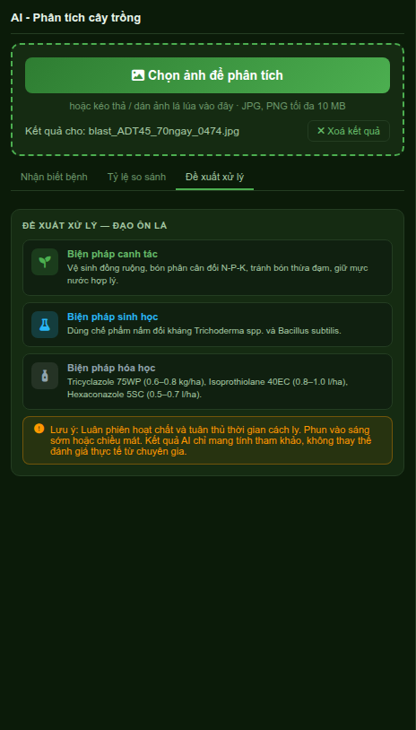</td>
  </tr>
  <tr>
    <td align="center"><b>Nhận biết bệnh</b><br/>tên bệnh, độ tin cậy, mức độ, top-3</td>
    <td align="center"><b>Tỷ lệ so sánh</b><br/>cây khoẻ / nhiễm bệnh</td>
    <td align="center"><b>Đề xuất xử lý</b><br/>canh tác · sinh học · hoá học</td>
  </tr>
</table>

### 3. Grad-CAM — AI đang nhìn vào đâu?

Bấm vào ảnh kết quả để phóng to, chuyển qua lại **Grad-CAM / Ảnh gốc**. Vùng đỏ/vàng là nơi model chú ý nhiều nhất khi quyết định.

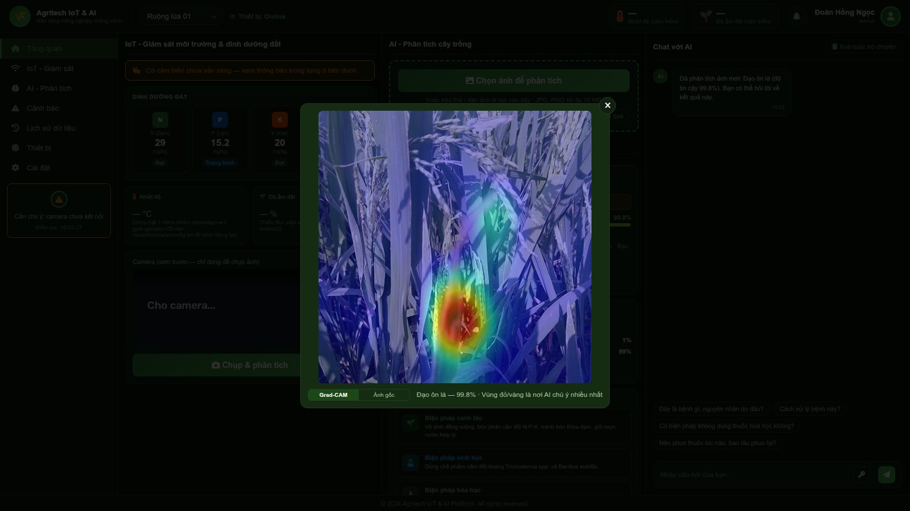

Grad-CAM trên cả 10 lớp (hàng trên: ảnh gốc, hàng dưới: Grad-CAM; ảnh mẫu trong `sample_images/`):

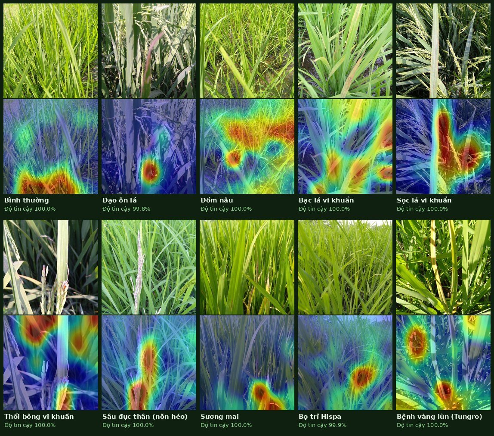

### 4. Chatbot tư vấn & lọc ảnh không phải lúa

<table>
  <tr>
    <td align="center">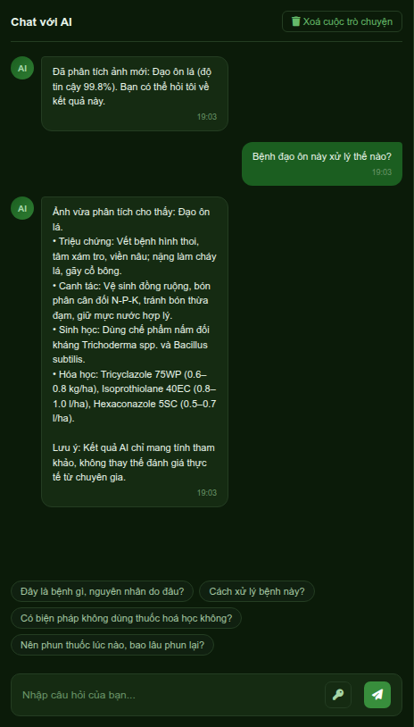</td>
    <td align="center">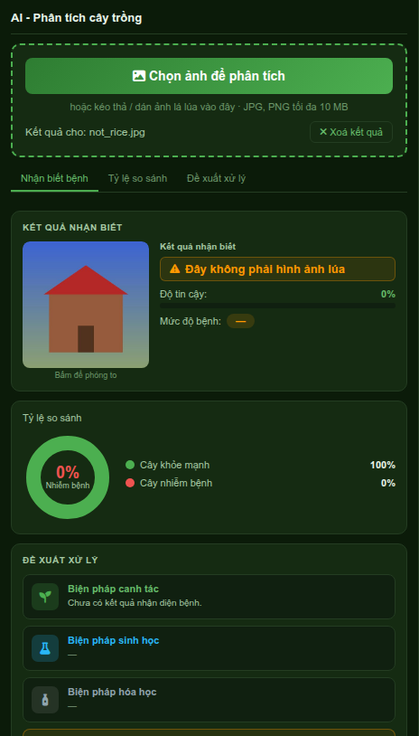</td>
  </tr>
  <tr>
    <td align="center"><b>Chat với AI</b> — hiểu ngữ cảnh ảnh vừa phân tích, có câu hỏi gợi ý,<br/>luôn kèm lưu ý "chỉ mang tính tham khảo".<br/>(Ảnh này: chưa có API key → dùng tư vấn có sẵn)</td>
    <td align="center"><b>Ảnh không phải lúa</b> — bị chặn bởi bộ lọc màu thực vật<br/>+ độ chắc chắn của model, không đưa ra bệnh sai.</td>
  </tr>
</table>

### 5. Các trang khác

| IoT — Giám sát | Cảnh báo |
|:---:|:---:|
| 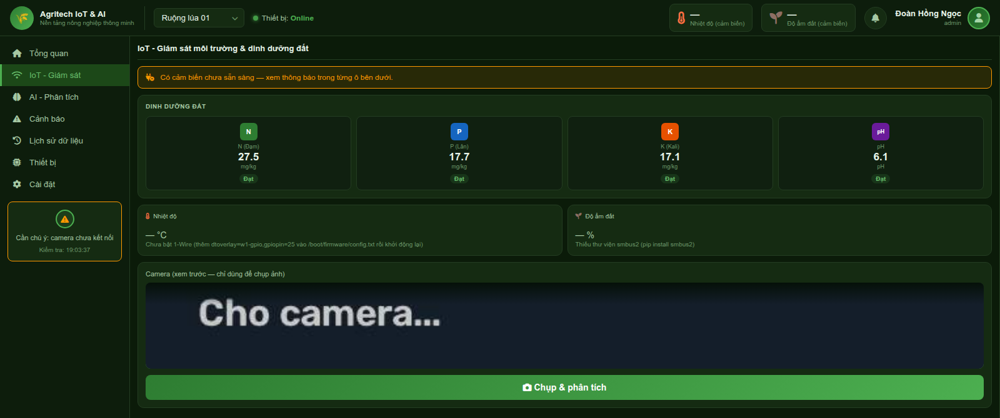 | 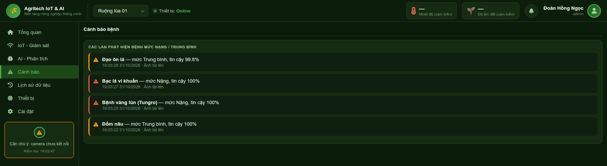 |
| N-P-K-pH, nhiệt độ, độ ẩm đất, xem trước camera + nút **Chụp & phân tích** | Các lần phát hiện bệnh mức **Nặng / Trung bình** |
| **Lịch sử dữ liệu** | **Thiết bị** |
| 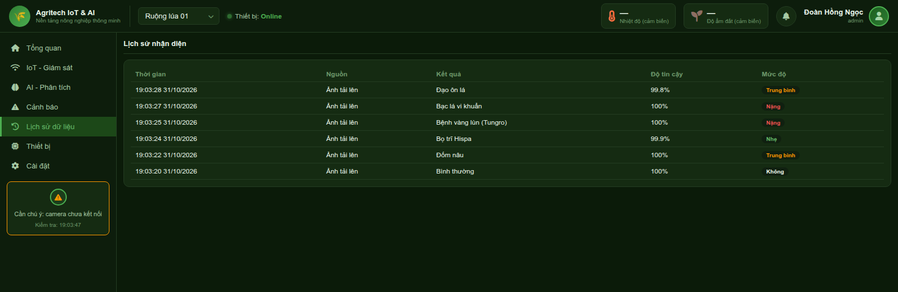 | 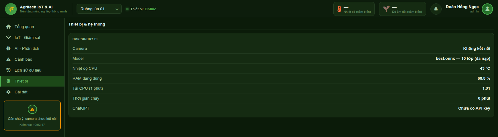 |
| Mọi lần nhận diện: thời gian, nguồn (camera / ảnh tải lên), kết quả, độ tin cậy, mức độ | Trạng thái camera, model, nhiệt độ CPU, RAM, tải CPU, ChatGPT |

**Cài đặt** — đổi API key ChatGPT, bật/tắt SMS cảnh báo (tối đa 5 số), gửi tin thử, bật/tắt lọc ảnh không phải lúa (áp dụng ngay):

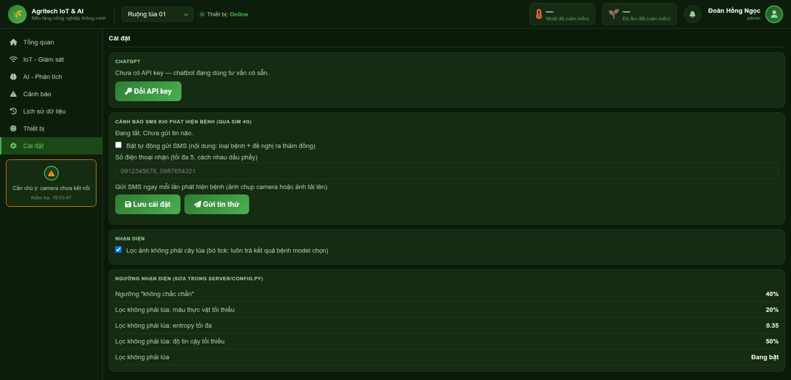

### 6. Dữ liệu & kết quả huấn luyện

**10 lớp trong Paddy Doctor** ([các collage từng bệnh](paddy_analysis_output/)):

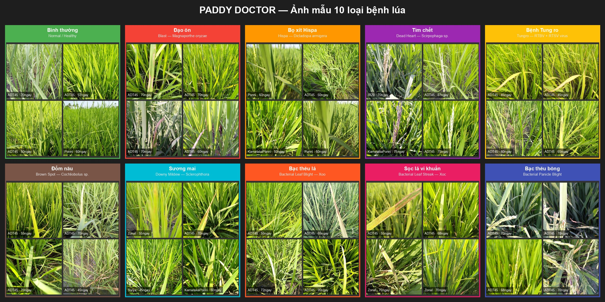

<table>
  <tr>
    <td align="center">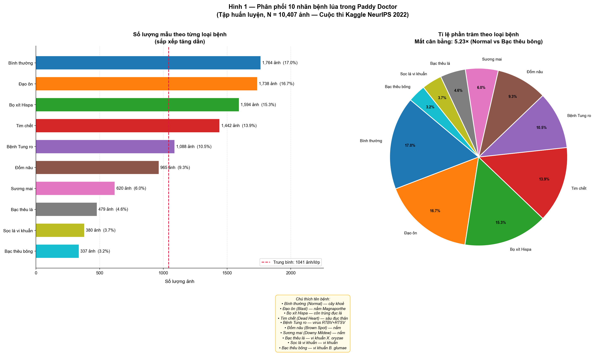</td>
    <td align="center">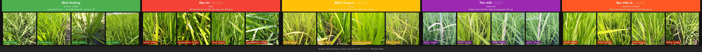</td>
  </tr>
  <tr>
    <td align="center">Phân phối số ảnh mỗi lớp (lệch tối đa ~5,2 lần)</td>
    <td align="center">Lúa bình thường so với lúa bệnh</td>
  </tr>
  <tr>
    <td align="center">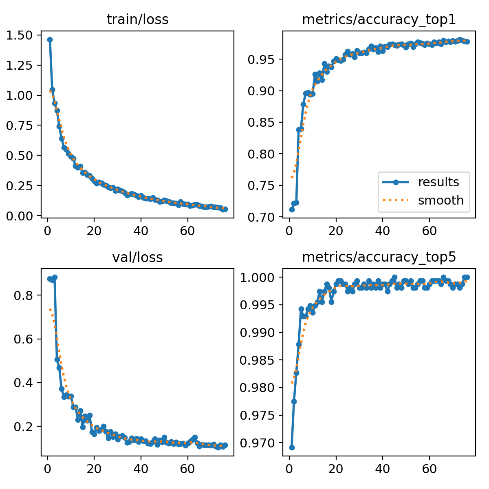</td>
    <td align="center">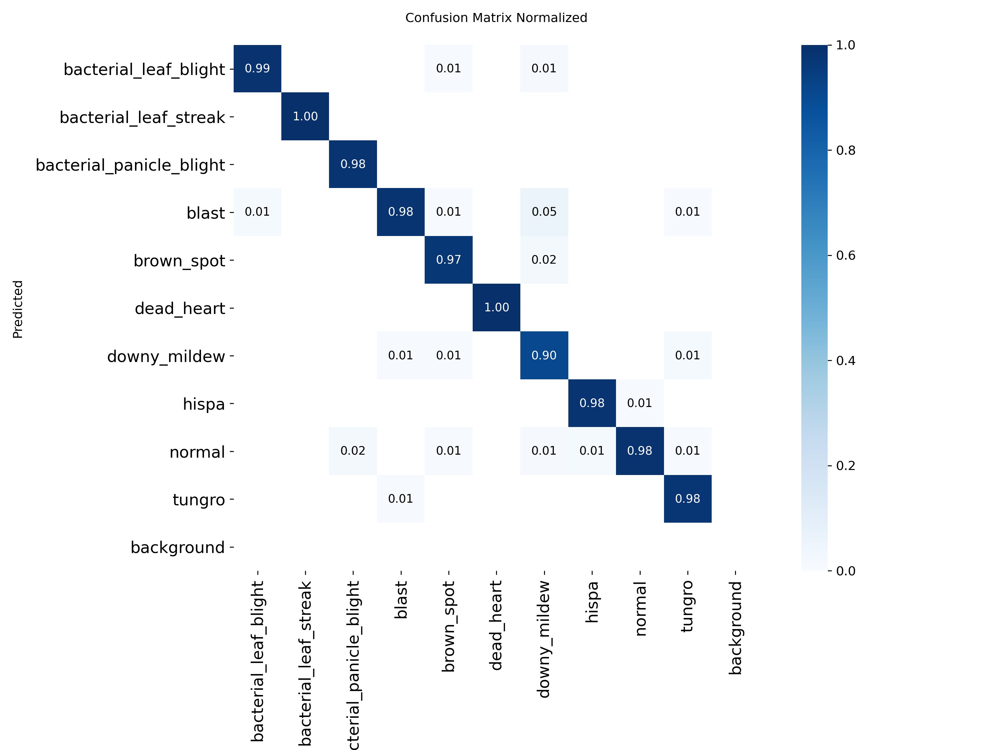</td>
  </tr>
  <tr>
    <td align="center">Loss & độ chính xác qua từng epoch (top-1 ≈ 98%)</td>
    <td align="center">Ma trận nhầm lẫn (chuẩn hoá) trên tập kiểm định</td>
  </tr>
</table>

Dự đoán của model trên một batch kiểm định:

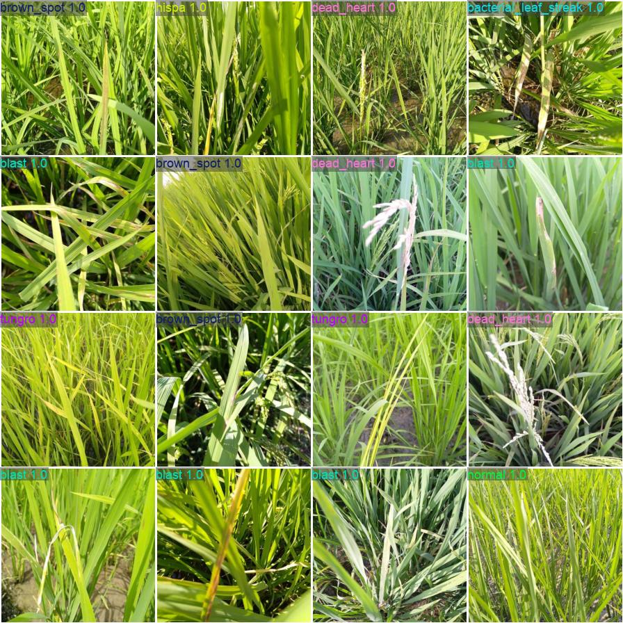

<!--
Ảnh phần cứng thực tế (Pi 4 + camera + SIM7600 + cảm biến lắp ngoài đồng): bỏ ảnh vào docs/images/hardware/
rồi thêm một mục "Phần cứng thực tế" ở đây, ví dụ:

-->

## Cài trên Raspberry Pi (3 lệnh)

```bash
# copy thư mục deploy_pi/ sang Pi (scp/USB), ví dụ ~/agritech
cd ~/agritech && chmod +x install.sh
./install.sh            # ALL-IN-ONE: apt + venv + pip + kiểm tra phần cứng + bật 4G + khởi động server
```

Mở `http://<ip-pi>:5000`. Hằng ngày dùng `./install.sh --restart` (kiểm tra + bật lại 4G + khởi động lại server);
`--check` chỉ kiểm tra, không đổi gì. Chi tiết các tuỳ chọn (`--apn`, `--tunnel`, `--camera`...) xem [DEPLOY.md](DEPLOY.md).

Chạy thử trên máy dev (không cần Pi/camera): `cd deploy_pi && pip install -r server/requirements.txt && python server/app.py`.

## Dashboard làm được gì

- **Chụp & phân tích** từ camera, hoặc **chọn / kéo thả / dán ảnh**. Camera chỉ để chụp, không suy luận liên tục.
- Kết quả: tên bệnh, độ tin cậy, mức độ, top-3, **Grad-CAM** (bấm vào ảnh để phóng to), biện pháp canh tác / sinh học / hoá học.
- Ảnh không phải lúa → báo "Đây không phải hình ảnh lúa" (lọc theo màu thực vật + độ chắc chắn của model).
- **Chat ChatGPT** có câu hỏi gợi ý; hiểu ngữ cảnh ảnh đang xem; đổi API key ngay trên web (hiệu lực tức thì).
  Mọi câu trả lời kèm lưu ý "chỉ mang tính tham khảo". Chưa có key / lỗi → tự dùng tư vấn có sẵn.
- Trang **Cảnh báo, Lịch sử, Thiết bị, Cài đặt**; lịch sử lưu ở `deploy_pi/data/history.jsonl`.
- Cảm biến: dinh dưỡng đất (N-P-K-pH) hiện là **dữ liệu giả lập**; nhiệt độ/độ ẩm báo "chưa sẵn sàng" cho tới khi cắm thiết bị.

## Cấu trúc

```
deploy_pi/                 ★ thư mục duy nhất cần copy sang Pi (~36 MB)
├── install.sh             ALL-IN-ONE: cài + kiểm tra phần cứng + bật/kiểm tra 4G + khởi động server
├── probe_ads1115.py       đọc điện áp 4 kênh ADS1115 (dò cảm biến analog trên I2C 0x48)
├── server/                Flask backend: app, camera, inference (+Grad-CAM), llm (ChatGPT),
│                          chatbot, sensors, history, config  → xem server/README.md
├── templates/agritech/    dashboard (HTML/CSS/JS thuần)
├── paddy_classify/weights/  best.onnx + best.cam.npy (trọng số Grad-CAM)
├── sample_images/         120 ảnh mẫu để thử
└── data/                  (tạo khi chạy) history.jsonl, openai_api_key — đừng chia sẻ

train.py                   chia dữ liệu → train → xuất ONNX → vá Grad-CAM → copy vào deploy_pi/
tools/add_cam_output.py    thêm output đặc trưng cho Grad-CAM vào ONNX (train.py tự gọi)
tests/chat_eval.py         30 case kiểm tra chất lượng chatbot (gọi OpenAI thật)
paddy_images/              dataset gốc, chỉ để train — không copy sang Pi
paddy_analysis_output/     báo cáo + biểu đồ phân tích dataset
result_training/           kết quả huấn luyện gốc (args.yaml, results.csv, ma trận nhầm lẫn, weights)
```

## Huấn luyện lại

```bash
pip install ultralytics onnx
python train.py                              # mặc định 100 epoch, ảnh 224, chia 85/15
python train.py --epochs 30 --batch 16       # chạy thử nhanh
python train.py --skip-export                # chỉ train, không ghi đè best.onnx đang dùng
```

`train.py` tự dò đường dẫn theo vị trí file. Sau khi train, nó ghi đè `deploy_pi/paddy_classify/weights/best.onnx`
(bản gốc ở `result_training/weights/best.onnx`) rồi tự vá thêm Grad-CAM — nhớ copy cả `best.cam.npy` sang Pi.
Muốn nhận diện ảnh "không phải lúa" chắc chắn hơn: thêm thư mục `paddy_images/not_rice/` rồi train lại (thêm 1 lớp).

## Lưu ý

- Thư mục không dùng git: `deploy_pi/` là bản code duy nhất, nên giữ một bản zip backup (không kèm `data/`).
- Dữ liệu xử lý bệnh trong `server/chatbot.py` (`TREATMENT`) **cần chuyên gia BVTV rà lại** theo danh mục thuốc BVTV hiện hành:
  theo tra cứu, Chlorpyrifos ethyl và Carbendazim (đang có trong dữ liệu) đã bị loại/cấm ở Việt Nam — chưa xác minh với danh mục mới nhất.
- Kết quả AI chỉ mang tính tham khảo, không thay thế đánh giá của chuyên gia.
