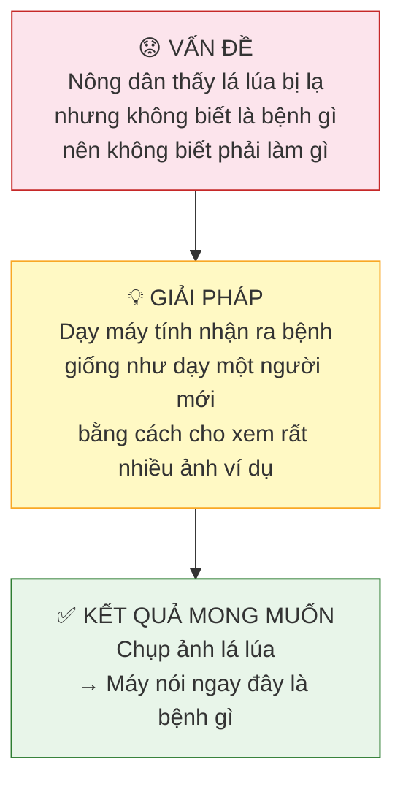
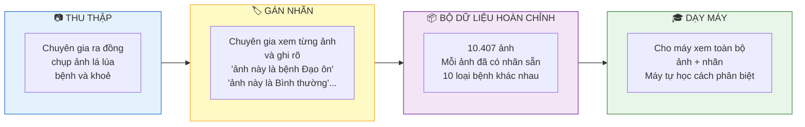
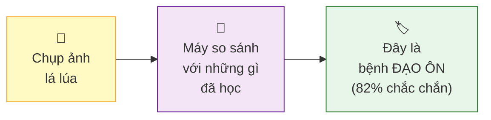
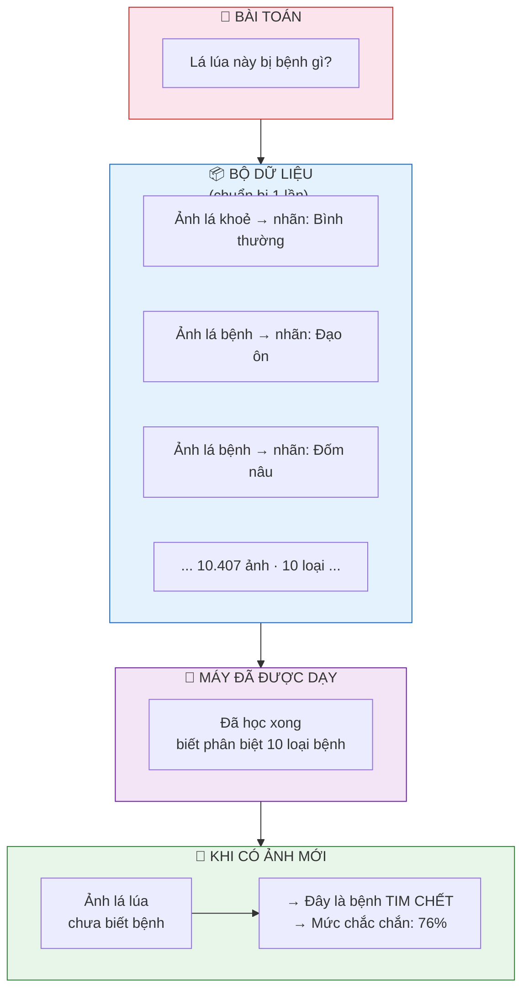

# Sơ đồ đơn giản — Paddy Doctor

> Xem trong VS Code: **Ctrl+Shift+V** | Hoặc paste vào **https://mermaid.live**

---

## Sơ đồ 1 — Tại sao cần làm cái này?

---

## Sơ đồ 2 — Xây dựng bộ dữ liệu như thế nào?

---

## Sơ đồ 3 — Khi có ảnh mới thì máy làm gì?

---

## Sơ đồ 4 — Toàn bộ câu chuyện trong 1 hình

---

*Paddy Doctor · 10.407 ảnh lá lúa · 10 loại bệnh · Ấn Độ · NeurIPS 2022*
