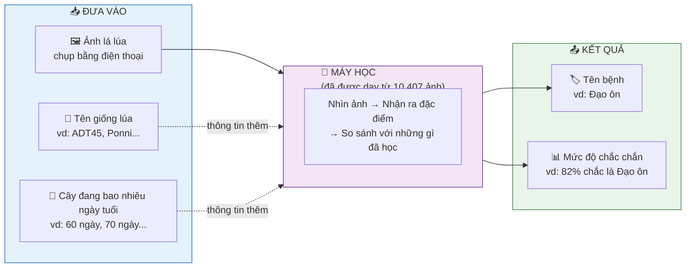
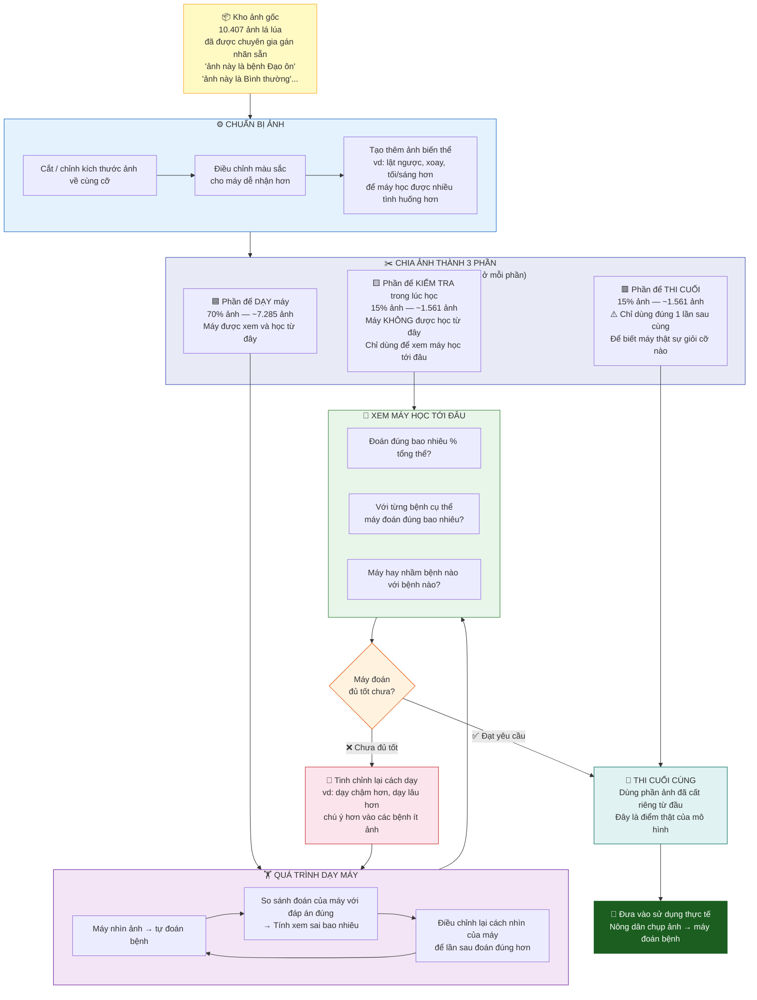
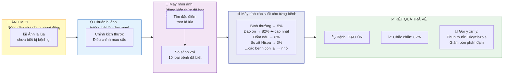
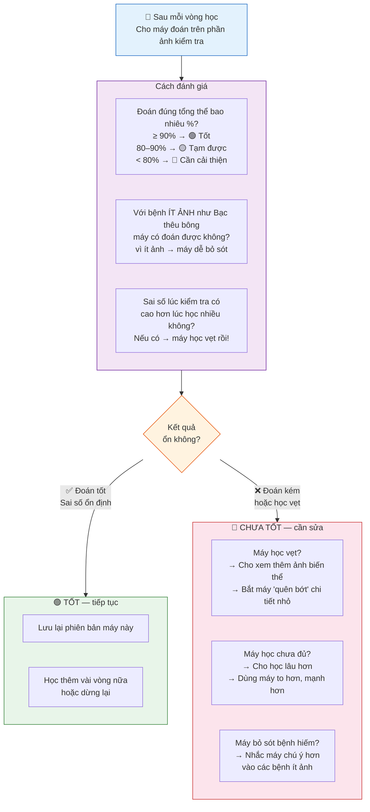
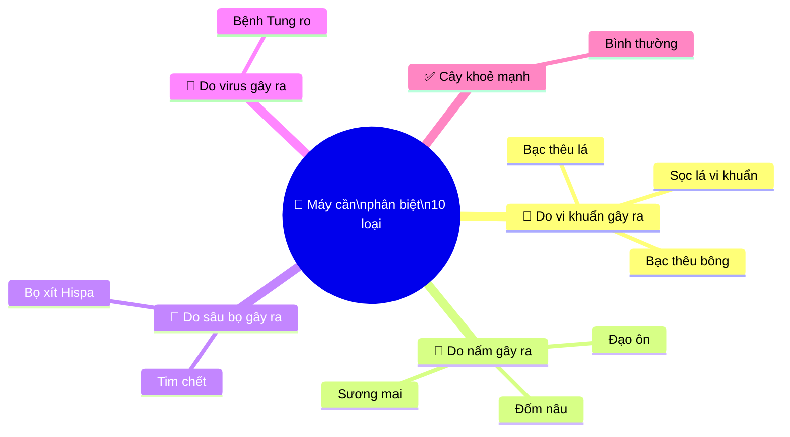
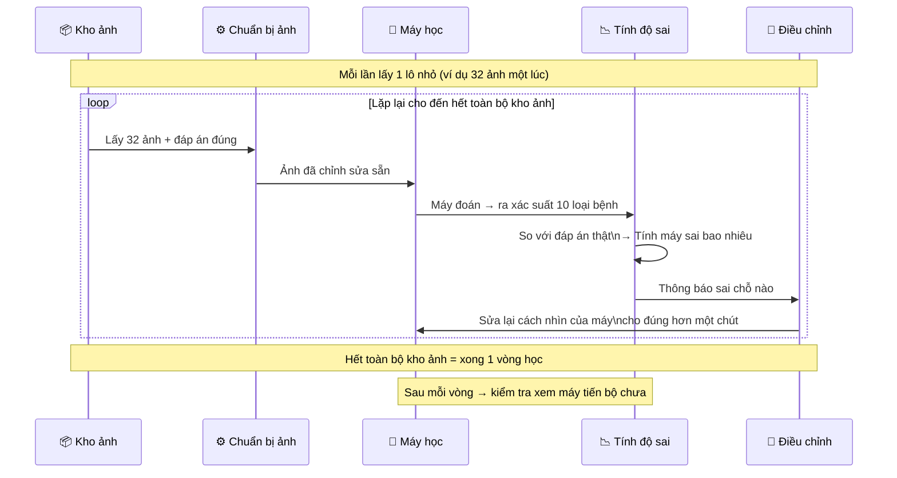

# Sơ đồ Mô hình — Paddy Doctor (Dành cho người mới)

> Xem trong VS Code: mở file → **Ctrl+Shift+V**
> Hoặc paste từng block vào **https://mermaid.live**

---

## Sơ đồ 1 — Đưa gì vào, nhận gì ra?

---

## Sơ đồ 2 — Quá trình dạy máy từ đầu đến cuối

---

## Sơ đồ 3 — Khi nông dân chụp ảnh mới và hỏi máy

---

## Sơ đồ 4 — Máy học xong rồi, tốt hay chưa?

---

## Sơ đồ 5 — 10 loại bệnh máy cần phân biệt

---

## Sơ đồ 6 — Một vòng học của máy trông như thế nào?

---

*Dữ liệu: Paddy Doctor — 10.407 ảnh lá lúa · 10 loại bệnh · Tamil Nadu, Ấn Độ · NeurIPS 2022*
